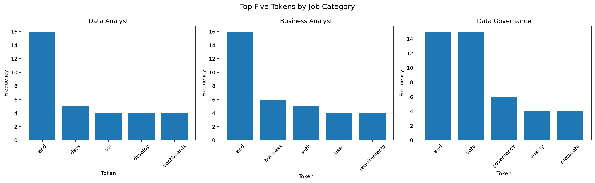
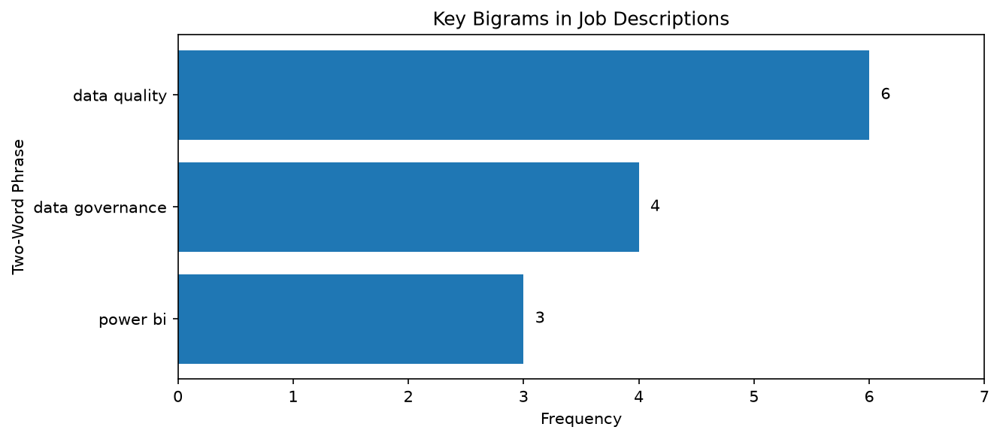

# Analytics Job Description Text Exploration

Web Mining and Applied NLP | Project 03 | Custom Project Report

## Overview

This project explores how vocabulary and language patterns differ across three analytics-related job categories: Data Analyst, Business Analyst, and Data Governance.

The goal is to examine individual word frequencies and relationships between words, including co-occurrence patterns and recurring two-word phrases.

The project builds on the text exploration techniques demonstrated in the instructor's example.

## Phase 4: Technical Modification

### Original Corpus

The instructor's example corpus contains 22 short documents organized into four categories:

- Dogs: 6 documents
- Cats: 6 documents
- Cars: 6 documents
- Trucks: 4 documents

### Modification

The original context window of 2 tokens was increased to 3 tokens.

A context window determines how many words on either side of a target word are considered nearby.

The same corpus and tokenization method were used for both experiments.

### Results

| Target Word | Window 2 | Window 3 | Additional Entries |
|---|---:|---:|---:|
| dog | 7 | 9 | 2 |
| cat | 8 | 9 | 1 |
| car | 8 | 11 | 3 |
| truck | 7 | 9 | 2 |

Increasing the window captured additional context for every target word.

Examples included `kennel` near `dog`, `road` near `car`, and `engine` and `loads` near `truck`.

The larger window also captured additional common words like `the`. This shows that a larger context window provides more surrounding information but does not necessarily produce more meaningful results.

The underlying corpus remained unchanged, so word frequencies and bigram counts were not changed.

### Phase 4 Notebook

The notebook includes executable Python code, the original and modified experiments, a comparison table, a visualization, and observations.

[View the Phase 4 Context Window Comparison Notebook](../notebooks/phase4_context_window_comparison.ipynb)

## Phase 5: Custom Application

For my custom application, I analyzed 12 paraphrased job descriptions across three categories:

| Category | Documents |
|---|---:|
| Data Analyst | 4 |
| Business Analyst | 4 |
| Data Governance | 4 |
| **Total** | **12** |

I used the same techniques from the instructor's example to compare word frequencies, vocabulary differences, co-occurrence patterns, and common two-word phrases.

### Results

The three job categories showed some differences in their most frequently used words.

- **Data Analyst:** Common terms included `develop`, `dashboards`, and `sql`.
- **Business Analyst:** Common terms included `business`, `user`, and `requirements`.
- **Data Governance:** Common terms included `governance`, `quality`, and `metadata`.

Across all 12 descriptions, `and` was the most frequent word, appearing 47 times. This showed that common words can dominate the results when stop words are not removed.

Looking at bigrams also revealed some interesting phrases:

| Bigram | Frequency |
|---|---:|
| data quality | 6 |
| data governance | 4 |
| power bi | 3 |

One thing I noticed was that the original code removed `BI` from `Power BI` because it was only two characters long. I changed the code to keep `bi`, which allowed the system to identify the complete phrase three times.

### Visualization

The chart shows the five most frequent tokens in each category. The word `and` appears most often in all three categories, which makes it harder to see differences in job related vocabulary. Removing stop words could help make those differences clearer.

### Key Bigrams in Job Descriptions

The word-frequency chart above shows individual words, while the chart below shows selected two-word phrases identified through bigram analysis. The analysis found "data quality" 6 times, "data governance" 4 times, and "power bi" 3 times. This shows how bigrams can identify meaningful phrases that may not stand out when examining individual words.

### Interpretation and Limitations

The results suggest that the Data Analyst descriptions focus more on technical reporting tools, Business Analyst descriptions emphasize users and requirements, and Data Governance descriptions focus more on data quality and management.

Because the dataset includes only 12 paraphrased job descriptions, these findings describe this sample rather than the entire job market.

The analysis also uses simple tokenization without general stop word removal, so common words such as `and` and `with` remain in the results.

If I continued this project, I would try removing stop words to see whether that makes it easier to identify differences between the job categories.

### Phase 5 Notebook

The notebook includes the Python analysis, frequency tables, co-occurrence results, bigrams, a visualization, and interpretation.

[View the Phase 5 Job Description Exploration Notebook](../notebooks/phase5_job_description_exploration.ipynb)

## Tools and Methods

- Python for text processing and analysis.
- Polars for frequency distributions and category comparisons.
- Context windows for word co-occurrence analysis.
- Bigrams for examining consecutive word pairs.
- Matplotlib for data visualization.
- Ruff, ty, and pytest for code verification.
- Zensical and GitHub Pages for published documentation.

## Documentation Index

- **Home** — This project report.
- [Project Instructions](project-instructions.md)
- [Glossary](glossary.md)

## Project Links

- [GitHub Repository](https://github.com/BethSpornitz/nlp-03-text-exploration-custom)
- [Python Analysis Script](https://github.com/BethSpornitz/nlp-03-text-exploration-custom/blob/main/src/nlp/nlp_corpus_explore.py)
- [Phase 4 Notebook](https://github.com/BethSpornitz/nlp-03-text-exploration-custom/blob/main/notebooks/phase4_context_window_comparison.ipynb)
- [Published Project Website](https://bethspornitz.github.io/nlp-03-text-exploration-custom/)
- [Custom Python Script](https://github.com/BethSpornitz/nlp-03-text-exploration-custom/blob/main/src/nlp/job_description_explore.py)
- [Phase 5 Notebook](https://github.com/BethSpornitz/nlp-03-text-exploration-custom/blob/main/notebooks/phase5_job_description_exploration.ipynb)

## Project Resources and Attribution

This project is adapted from the instructional example developed by Denise M. Case for Web Mining and Applied NLP.

- [Original Example Repository](https://github.com/denisecase/nlp-03-text-exploration)
- [Professional Python Guide](https://denisecase.github.io/pro-analytics-02/)
- [Professional Python Project Explainer](https://pup-pack.github.io/professional-python-project-explainer/)
